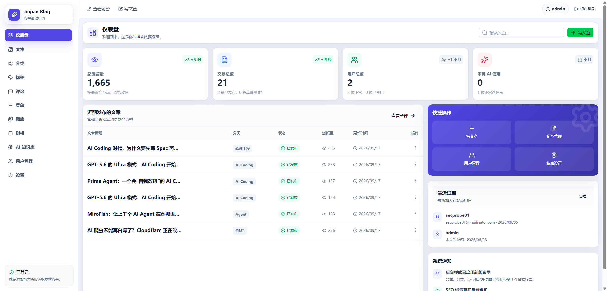
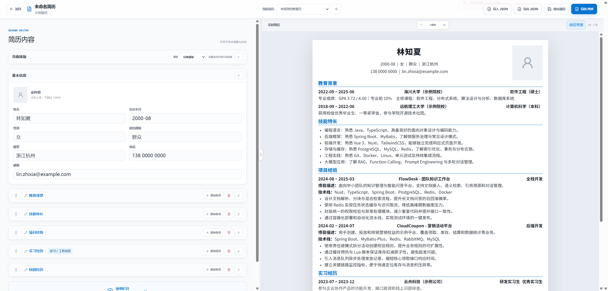

# Jiupan Blog

Jiupan Blog 是我用 Nuxt 4 搭建的个人博客，带文章编辑后台，支持用 Docker 自托管。文章、评论和站点设置都保存在 PostgreSQL 里。

[在线博客](https://blog.ittx.cn/) · [功能](#features) · [本地运行](#quick-start) · [AI 配置](#ai-knowledge) · [部署](#deployment) · [文档](#documentation)


<a id="features"></a>

## 功能

- **写博客。** 用 Markdown 写文章、存草稿、上传封面和配图，在后台管理分类、标签、书签、菜单和侧栏。读者可以从归档、分类和标签页找文章，也可以用站内搜索。评论支持访客留言、楼中楼和后台审核。
- **写稿和检查。** 配置模型后，可以在编辑时生成摘要和 SEO 文案，发布前检查外链，也可以找适合补进文章的旧文。用本地 Agent 写稿时，可以通过 API 上传配图、创建草稿，再到后台预览和发布。 [Agent API 文档](docs/agent-api.md)
- **搜索和追问。** 在「问问博客」里输入一个问题，可以查找站内资料并打开答案里引用的文章。读到一半想问某段代码为什么这么写，也可以在文章页发起对话，回答会基于当前这篇文章，对话可在下次阅读时继续。
- **管理知识库。** 可以索引博客文章，也可以上传 Markdown、TXT、PDF 或 DOCX 作为独立资料。在后台能看同步进度、重试失败的任务，也能输入问题测试检索，看看找到了哪些段落。
- **做简历。** 在简历工坊里编辑栏目、切换模板、预览 A4 排版，支持 JSON 导入和备份。登录后可以在线保存多份简历并导出 PDF。

| 管理后台 | 简历工坊 |
| --- | --- |
|  |  |

<a id="quick-start"></a>

## 本地运行

需要 Node.js 22、npm 和 Docker Compose。以下命令在仓库根目录执行。

```bash
npm ci
cp .env.example .env
```

PowerShell 下用 `Copy-Item .env.example .env` 复制配置。编辑 `.env`，把 `NUXT_SESSION_PASSWORD` 换成至少 32 个字符的随机值，给 `ADMIN_PASSWORD` 设置至少 12 个字符的独立密码。`ADMIN_USERNAME` 默认为 `admin`，数据库连接默认对应本地 Compose 配置。

```bash
docker compose up -d postgres
npx prisma migrate deploy
npm run prisma:generate
npx tsx --env-file=.env prisma/seed.ts
npm run dev
```

Seed 会初始化管理员和一篇示例文章。启动后打开 [博客首页](http://localhost:3000/) 或 [后台登录](http://localhost:3000/admin/login)。[AI 实验室](http://localhost:3000/lab) 和 [工具箱](http://localhost:3000/tools) 也在同一个站点里。

在本地使用服务端 PDF 导出前，运行 `npx playwright install chromium` 安装浏览器。Linux 上可以用 `npm run playwright:install` 一并安装系统依赖。生产 Docker 镜像已包含浏览器。

<a id="ai-knowledge"></a>

## AI 配置

博客、后台和评论可以直接运行，AI 功能按需开启。对话模型用于写作、总结和问答，Embedding 模型用于给文章和文件建立索引。可在「后台 → AI 知识库 → 模型与检索」填写模型地址和密钥。下面是使用 `.env` 配置的示例。

```env
AI_API_KEY=""
AI_BASE_URL="https://api.deepseek.com"
AI_MODEL="deepseek-v4-flash"

AI_EMBEDDING_API_KEY=""
AI_EMBEDDING_BASE_URL="https://api.openai.com/v1"
AI_EMBEDDING_MODEL="text-embedding-3-small"
AI_EMBEDDING_DIMENSIONS="1536"
```

模型地址需兼容对应的 OpenAI API。Embedding 输出需要是 1536 维，与数据库的 `vector(1536)` 一致。填好后，在后台同步文章或上传知识文件，等索引完成再到实验室试搜。检索结果也可以通过 Rerank 模型重新排序，可在同一配置页开启。

同一项配置同时出现在环境变量和后台时，优先使用非空的环境变量。环境变量改动需要重启开发服务或重新创建应用容器。

<a id="deployment"></a>

## 部署

仓库提供 [Dockerfile](Dockerfile) 和 [生产 Compose 配置](docker-compose.server.yml)。部署时使用 HTTPS，设置正式域名 `SITE_URL`，并持久化 PostgreSQL、图片上传目录和知识文件目录。

这个站点使用 GitHub Actions 构建镜像、推送到阿里云 ACR，再由服务器拉取镜像并执行数据库迁移。所需的变量、密钥和服务器配置见 [ACR 部署手册](docs/deploy-acr.md)。更换域名时可参考 [SEO 配置](docs/seo.md)。

<a id="architecture"></a>

## 开发

项目使用 Nuxt 4、Vue 3 和 TypeScript，界面基于 Nuxt UI 与 Tailwind CSS。服务端用 Nitro 和 Prisma 访问 PostgreSQL，知识库向量检索使用 pgvector。

| 目录 | 用途 |
| --- | --- |
| `app/` | 前台、后台页面及组件 |
| `server/api/` | API 路由、鉴权和参数校验 |
| `server/services/` | 文章、评论、图库、用户和 AI 等业务逻辑 |
| `prisma/` | 数据库结构、迁移和种子数据 |
| `tests/` | Vitest 测试 |

```bash
npm run lint
npm run typecheck
npm test
npm run build
```

修改数据库结构时，用 `npm run prisma:migrate` 在开发库生成迁移，并提交 `prisma/schema.prisma` 和对应迁移文件。

<a id="documentation"></a>

## 文档

- [项目架构](docs/architecture.md)、[API 边界](docs/api-boundaries.md)、[Agent API](docs/agent-api.md)
- [图库管理](docs/gallery-management.md)、[评论系统](docs/comments-handover.md)、[Twikoo 评论迁移](docs/comments-import.md)
- [认证与限流](docs/security-policy.md)、[缓存策略](docs/content-cache-strategy.md)、[SEO](docs/seo.md)
- [阿里云 ACR 部署](docs/deploy-acr.md)
